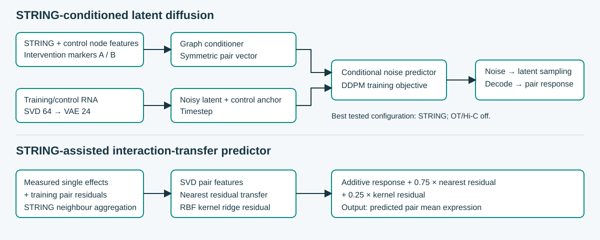
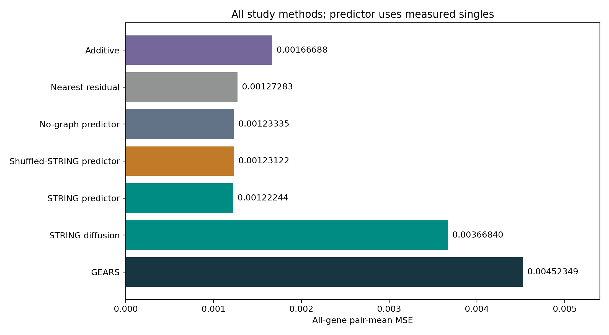
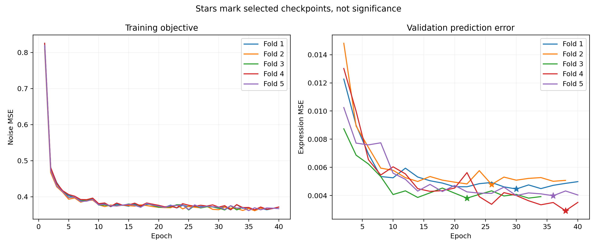
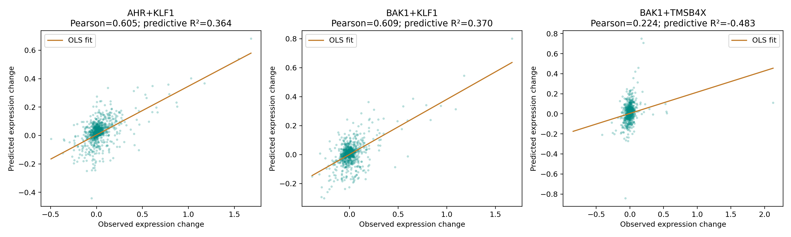
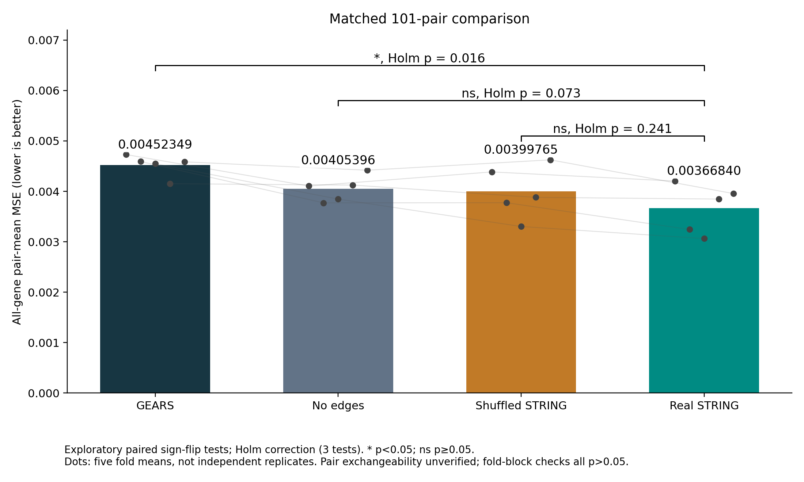
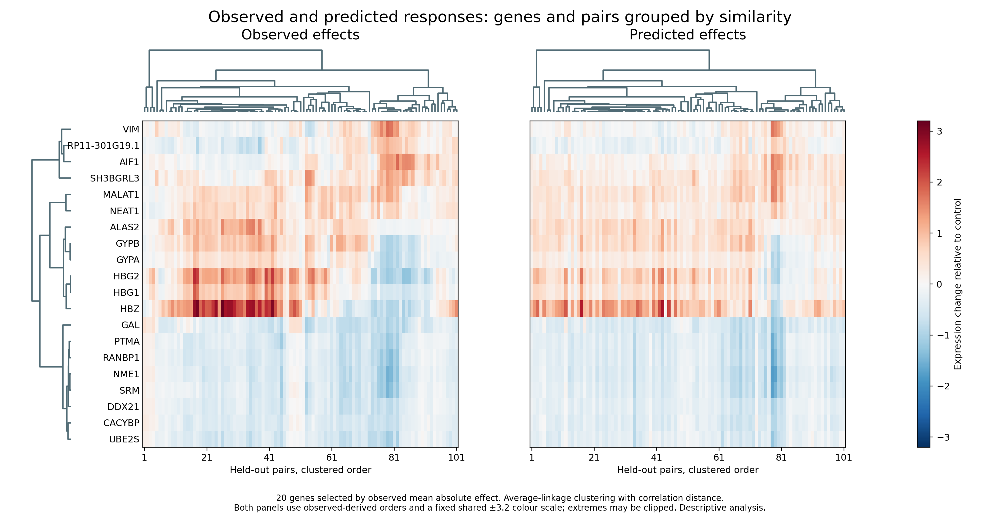
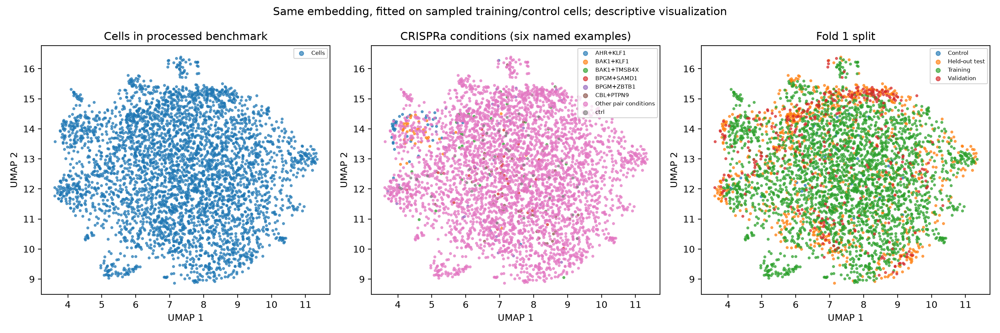

# Graph-informed perturbation prediction

**Two complementary models for held-out gene-pair response prediction.**

Rewant Anand · IIIT-Delhi · Research prototype

[Models](docs/ARCHITECTURES.md) · [Reproduce](docs/REPRODUCTION.md) · [Data](docs/DATA_AND_ENVIRONMENT.md) · [Figures](figures/README.md) · [Audit](docs/GEARS_REPRODUCIBILITY_AUDIT.md)

## Overview

Can biological interaction priors help predict a gene combination whose response was not used for training? This repository studies **101 held-out Norman CRISPRa gene pairs**, across **five custom study folds (not the published GEARS default split)** and **5,045 expression genes**, using two approaches:

- **STRING-conditioned latent diffusion:** an expression representation (SVD → VAE) and a parallel intervention-aware graph conditioner guide noise prediction and latent generation.
- **STRING-assisted pair predictor:** measured single-gene responses provide an additive prediction; nearest-neighbour and graph-kernel branches estimate interaction residuals.

The scope is **held-out combinations**, not established zero-shot generalisation to entirely unseen intervention genes. The predictor explicitly uses measured single-gene responses. Diffusion training uses training-pair and control cells; GEARS also has single-gene training conditions. These differences in available information matter when interpreting the comparison.



## Results

Condition-mean all-gene MSE, averaged equally over 101 pairs; lower is better. These are exploratory results on a repeatedly examined cohort.

| Method | MSE |
| :--- | ---: |
| Additive baseline | 0.00166688 |
| Nearest-residual baseline | 0.00127283 |
| Predictor without graph | 0.00123335 |
| Predictor with shuffled STRING | 0.00123122 |
| **STRING-assisted predictor** | **0.00122244** |
| Diffusion without edges | 0.00405396 |
| Diffusion with shuffled STRING | 0.00399765 |
| **STRING + VAE + diffusion** | **0.00366840** |
| GEARS, original saved checkpoints | 0.00452349 |

The diffusion configuration uses STRING, with **Hi-C and OT disabled**. Its MSE is 18.9% lower than the original saved GEARS run, while both simple baselines have lower MSE than diffusion. Real STRING's small predictor gain over no graph and its shuffle remains exploratory. Hi-C was tested as a separate relation and did not consistently improve results.

**Reproduction status:** the uploaded baseline, predictor and diffusion reruns match the saved per-pair scores exactly. Rescoring all original GEARS checkpoints agrees within 2.14 × 10⁻⁹ per pair. **Fresh GEARS training is not established as an exact reproduction:** fresh fold 1 scored 0.00391132 versus 0.00473009 for the original fold-1 checkpoint. On that fold, diffusion scored 0.00420399. Do not compare a single fold with the five-fold aggregate, or describe the original 18.9% advantage as robust across retraining. See the [audit](docs/GEARS_REPRODUCIBILITY_AUDIT.md).



## Quick start: inspect the supplied evidence

```bash
python verify_release.py
```

This standard-library check verifies source syntax, split consistency, saved scores, uploaded reproduction reports and the release manifest. It **does not train models** or verify your installed GPU environment.

To regenerate saved result figures, install the plotting dependencies in your existing working environment:

```bash
python -m pip install numpy scipy matplotlib
python make_saved_figures.py
```

Outputs are written to `work/saved_figures/`; the curated figures already included in `figures/` remain available for browsing. UMAP needs the expression dataset and the additional data-analysis dependencies.

## Run the study

Use the exact processed dataset described in [Data and environment](docs/DATA_AND_ENVIRONMENT.md). No expression dataset or model weights are bundled. `requirements.txt` lists compatibility ranges; `environment-used.txt` records the supplied working environment and is not a portable CUDA installation recipe. Install a suitable PyTorch build, then the study dependencies. GEARS needs its backend and compatible PyG in addition to the main requirements.

```bash
python -m pip install -r requirements.txt
python -m pip install -r requirements-gears.txt
python prepare_local.py --data /absolute/path/to/perturb_processed.h5ad
python check_dataset.py --data /absolute/path/to/perturb_processed.h5ad
python run_study.py preflight
python code/run_validation_selected.py --self-test
python run_study.py baseline
python run_study.py predictor
python run_study.py diffusion --fold 1 --device cuda:0
```

After checking the fold-1 outputs, run the full protocol:

```bash
python run_study.py diffusion --all-folds --device cuda:0
python run_study.py diffusion-controls --all-folds --device cuda:0
python run_study.py gears --all-folds --device cuda:0
python run_study.py figures
python run_study.py data-figures --fold 1
```

GEARS retraining writes a new result. The comparison wrappers use archived GEARS evidence by default; to use the new run, explicitly pass `--gears-results work/results/gears_retrained.json` to the relevant predictor/diffusion command. Follow the [reproduction guide](docs/REPRODUCTION.md) for checkpoint signatures and comparisons. Do not disable signature checks to reuse incompatible outputs.

## Figure gallery

| Generation and prediction | Expression agreement |
| :---: | :---: |
|  |  |
| Training noise loss and validation expression error; stars mark selected epochs. | Pair-level Pearson and predictive R²; these measure different properties. |
|  |  |
| Four-method MSE comparison with calculated exploratory significance annotations. | Observed and predicted effects use the same similarity-based row/column ordering. |



The UMAP is descriptive: cells, CRISPRa conditions and the fold-1 split. Neutral cell labels preserve the source annotation discrepancy. It does not demonstrate predictive accuracy or an independent biological replication.

Mean Pearson = **0.642**, mean Spearman = **0.287**, mean predictive R² = **0.249** across the 101 pairs. The [figure guide](figures/README.md) explains selection, scaling and statistics. A pair-level GEARS comparison has Holm-adjusted p = 0.0157; the fold-block sensitivity result is p = 0.0625. No significance is claimed for STRING versus shuffled STRING or no edges after correction. Shared genes and training data limit independence.

## Repository guide

| Location | Contents |
| :--- | :--- |
| `code/` | Both architectures, baselines, graph processing and plotting |
| `code/gears/` | Resumable GEARS training, scoring and compatibility wrappers |
| `graphs/` | Frozen STRING and Hi-C mappings used by the study |
| `evidence/` | Saved results, five-fold splits, histories and expression export |
| `evidence/reproduction/` | Uploaded rerun reports, dataset fingerprint and computed audit |
| `figures/` | Curated PNG/PDF figures, architecture SVG and plotting notes |
| `docs/` | Algorithms, evaluation, provenance, reproduction and presentation map |
| `archive/` | Historical provenance utilities; not the main study entry point |
| `work/` | Local outputs created when you run commands; excluded from Git |

## Limitations and next steps

This is a research prototype, not a validated prediction service. The cohort was examined repeatedly; one training seed does not establish robustness. Compression ablations and equal-information comparisons are still needed. Hi-C support is sparse (14 strict edges, 9 of 65 targets connected), and raw Hi-C reconstruction needs an additional historical helper/reference files. The processed Norman archive carries an `A549` annotation inconsistent with its expected K562 context; the annotation is preserved and its provenance documented.

Next steps are matched multi-seed GEARS/diffusion retraining, untouched cohorts, SVD/VAE ablations, improved Hi-C mapping with shuffled controls, and compatible TxPert/Squidiff comparisons. No result against those models is claimed here.

## References and contact

- [GEARS source](https://github.com/snap-stanford/GEARS)
- [Norman et al., combinatorial perturbations](https://doi.org/10.1126/science.aax4438)
- [STRING](https://string-db.org/)
- [Strong linear baseline study, Nature Methods](https://www.nature.com/articles/s41592-025-02772-6): benchmark evidence, not a theorem that linear models always win.
- [Squidiff](https://github.com/siyuh/Squidiff): repository presentation reference; its implementation is not included or benchmarked here.
- [Rewant Anand](https://github.com/Rewant05)

This prototype has no claimed publication or acceptance. Preserve third-party attribution and terms; select an explicit project license before representing it as licensed for redistribution.
